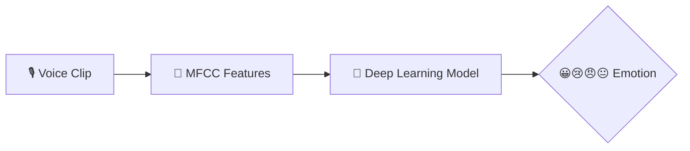

<div align="center">


<b><i>Recognise emotions from speech with deep learning</i></b>


       

   
</div>

---

## 🎙️ About the Project

Upload a voice clip and the app recognises the speaker's **emotion — happy, sad, angry or neutral**. Audio features (MFCCs) are extracted with **Librosa** and classified by a **Keras deep-learning model**, all wrapped in a Flask web app with login.

## ✨ Key Features

- 🎧 Upload a speech clip for analysis
- 🎼 **MFCC feature extraction** with Librosa
- 🧠 Keras model `voice_emotion_model.h5`
- 🏋️ Training (`train_voice_emotion.py`) & CLI prediction (`predict_voice_emotion.py`) scripts
- 🔐 Signup / login + about page

## 🧠 How It Works



## 🛠️ Tech Stack

| Layer | Technology |
|---|---|
| Language | Python 3 |
| Audio | Librosa |
| Deep Learning | TensorFlow / Keras |
| Web | Flask · HTML5 · CSS3 |

## 📂 Project Structure

```text
VOICE-EMOTION-DETECTION/
├── app.py · app1.py
├── train_voice_emotion.py
├── predict_voice_emotion.py
├── voice_emotion_model.h5 · label_encoder.pkl
├── requirements.txt
└── templates/ (index, login, signup, result, about)
```

## 🚀 Getting Started

```bash
git clone https://github.com/PreciousBharath/VOICE-EMOTION-DETECTION.git
cd VOICE-EMOTION-DETECTION
pip install -r requirements.txt
python app.py
```

## 🤝 Contributing

Contributions, issues and feature requests are welcome! Feel free to ⭐ star the repo and open a pull request.

## 👨‍💻 Author

<div align="center">

**Bharath** — Software Developer · Project Engineer · Technical Trainer

<a href="https://github.com/PreciousBharath"></a>
<a href="https://linkedin.com/in/connectbharath"></a>

### 🍔 EAT · 😴 SLEEP · 💻 CODE · 🔁 REPEAT

⭐ **If you found this project useful, give it a star!** ⭐


</div>
